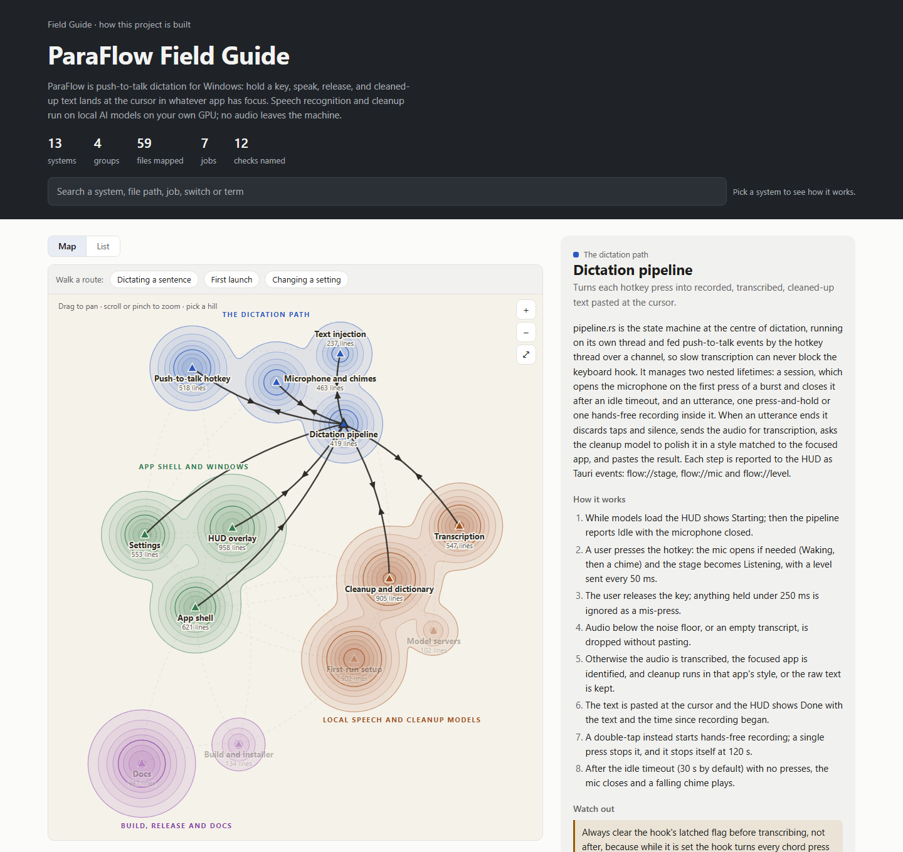

# Field Guide

A plain-English field guide to every system in your repository, checked
against the code, built and kept honest by Claude Code.

The guide is one JSON file (`docs/field-guide/guide.json`) that puts every file in
your repo into a named **system** and describes each one: what it does, how it
works step by step, its key files, the jobs it runs, the switches that change
its behaviour, what it connects to, the traps to avoid, and the rules and
tests that guard it. It comes with:

- **a one-entry lookup** (`node docs/field-guide/guide.mjs <id | path | word>`), so
  a Claude session reads one system's entry (typically 1-2.5k tokens) instead
  of the whole map or the code cold;
- **a check for CI** (`node docs/field-guide/guide.mjs check`) that fails when a file
  belongs to no system or when anything the guide names no longer exists;
- **a single-page HTML view** for people (`node docs/field-guide/guide.mjs render`),
  which opens on a trail map of the systems (below); offline, light and dark,
  phone to desktop.

The plugin builds the guide with parallel drafting subagents, then has a
second set of **adversarial** subagents fact-check every claim against the
code before it is accepted.

<picture>
  <source media="(prefers-color-scheme: dark)" srcset="docs/images/paraflow-map-dark.png">
  
</picture>

*The rendered page for the bundled [ParaFlow example](examples/paraflow/):
pick a hill and its entry opens beside the map, while its trails light up.*

> Status: 0.2.1. Tested on two outside repositories (below). See
> [`examples/paraflow/`](examples/paraflow/) for a complete guide and its
> rendered page.

## The trail map

`render` opens on a map of the guide, drawn as terrain:

- **Hills are systems.** A hill's footprint grows with the lines of code the
  system owns, and its height (its contour rings) with the branch points in
  that code. A wide, low hill is a lot of plain code; a small, steep one is
  dense logic. A system with no code is a flat marker.
- **Regions are groups.** A group's hills share one landmass in the group's
  colour, named on its edge.
- **Trails are connections.** Each `connects` entry is a trail between two
  hills. Pick a hill to light its trails, with arrows for the way each one
  runs, and point at a trail to read why it exists.
- **Routes are flows.** Pick a route above the map and a marker walks it, stop
  by stop, with each step's sentence.

Sizes are counted from the code each time you render, never typed by hand. The
footprint's radius grows with the square root of a system's lines of code, so
its area roughly follows the code. Lines are the non-blank lines in code files,
which leaves out prose, data and config files, lockfiles, binaries, and
generated and minified files. Height grows with the square root of its branch
points: a count of `if`, `elif`, `for`, `foreach`, `while`, `case`, `catch`, `except`,
`when`, `match`, `&&`, `||` and a spaced `?`. It is a count, not a parser, so it also
matches inside strings and comments; that is fine for comparing systems within
one repo.

The layout comes from the guide's structure (groups and connections), and from
the code's size only in coarse steps, one per doubling of lines. A commit that
leaves the groups, the connections and the size steps alone moves no hill, and
a system that crosses into the next step moves the hills around it only a
little, so a reader can learn the map. The map is the default view when the
window is at least 860px wide; the list of tiles is the default below that, and
your choice is remembered in the browser.

Two flags change what `render` writes:

```
node docs/field-guide/guide.mjs render --map-only map.html   # just the map, the route bar and the entry panel
node <field-guide>/dist/guide.mjs render --guide docs/architecture.json --map-only docs/architecture-map.html
```

`--guide <file.json> [--root <folder>] [--config <file>] <out.html>` draws a
guide that other tooling maintains and that has no `guide.config.json`. It reads
the JSON and writes only the page you name, so an output path is required. The
repo root defaults to the git top level of the JSON's folder; `--root` names
another. `--config` supplies a `guide.config.json`-shaped file (`include`,
`exclude`, `prose`) that says which files count; without it, every file git
lists counts, except those in the JSON's own folder. `--map-only` works with
`--guide` too.

## Where it comes from

Field Guide is a side project from [SiliconExchange](https://www.siliconexchange.io),
a US marketplace for buying and selling PC hardware. We built the first
version to map our own codebase, so that we and our Claude sessions could find
our way around it without reading the code cold. Then we generalized it,
tested it on projects we did not write, and published it here.

## Why not a code graph?

Code-graph tools parse your source into nodes and edges. They are fast and
good at one question: "what calls this?" A guide answers a different one:
"what is this part of the system for, how does it work, and what will bite me
if I change it?" We ran both on the same commit of a Tauri app (ParaFlow: Rust
backend, React front end, PowerShell scripts, 57 files at that commit), using Graphify both
as the open-source package (code-only mode) and as the hosted service.

| | Graphify, local (0.9.73, code-only) | Graphify, hosted | Field Guide |
|---|---|---|---|
| Unit of answer | a node and its edges | a node and its edges, or code bodies for a question | a named system, in sentences |
| Files covered | 30 of 57 had a node | code and the README; no node for the user guide, the CSS or the installer hook | all 57: the check fails while any file has no owner |
| Calls between Rust modules | 1 of 33 `module::fn()` calls found | 5 of 5 sampled functions, 17 call sites, all correct | not a call graph |
| React UI to Rust backend (Tauri `invoke()`) | 0 edges | none seen | in `connects` and the journeys |
| Environment switches (9 `PARAFLOW_*`) | 0 | 0 | 9, each still proven present by the check |
| Stale comments and docs | served as written | served as written | contradictions found and called out |
| Cost to build | 3 seconds, no tokens | hosted | 21 minutes, about 1.4M subagent tokens |

Use a graph, or grep, for exact call sites. Use a guide to orient before you
open the code. They work well together. On SiliconExchange's own private
TypeScript codebase (732 code files), the local graph found 70 of the 74
caller files that grep found for 20 functions, with no false hits.

## Does it save tokens?

On code changes, yes; on quick questions, not measurably. We ran a blind A/B
test on SiliconExchange's private codebase (about 1,170 tracked files, 24
systems), using our internal original of this guide (same lookup, same check)
and a CLAUDE.md block like the one the build offers. 36 fresh Claude Code
sessions (Opus 5.5, xhigh effort) ran six tasks three times each, with the
guide and with every trace of it removed. Answer keys were written from the
code before any run, and grading was blind.

- **Code changes:** about 30% fewer tokens processed and about a third less
  context growth, with the same accuracy. The sessions that used the guide
  also fixed its entry in the same change, and still came out cheaper.
- **Finding and explaining:** no difference beyond run-to-run noise (about
  ±20%). On some questions sessions grepped and never opened the guide.
- **Accuracy:** a tie, about 92% of the answer keys in both arms.

That is one repo, one model and three runs per task: an indication, not a
guarantee. No run came near the context window's limit, so the saving is
tokens, not room.

## Install

In Claude Code:

```
/plugin marketplace add AlphaGator1/field-guide
/plugin install field-guide@field-guide
```

Or from a shell: `claude plugin marketplace add AlphaGator1/field-guide`, then
`claude plugin install field-guide@field-guide`. To try a local checkout
without installing: `claude --plugin-dir ./field-guide`.

Requirements: Node 18 or newer (the CLI is one dependency-free file), and git
(the check lists files with `git ls-files`).

## Use

| Command | What it does |
|---|---|
| `/field-guide:build` | Builds the guide: inventory, a proposed grouping for you to confirm, parallel drafting, adversarial fact-check, the check, and the wiring you choose (a CLAUDE.md block or a project skill; a GitHub Actions job or a package script). |
| `/field-guide:update [commit]` | After code changes: lists the systems whose files changed since the guide was last verified, searches the guide for the old values the diff replaced, re-checks those entries against the diff, places new files, re-runs the check. |

Both are user-invoked only: Claude never starts a build on its own, because a
build spends real tokens.

The build vendors the CLI into your repo as `docs/field-guide/guide.mjs`, so CI and
teammates run it with plain `node`, without the plugin:

```
node docs/field-guide/guide.mjs                  # every system, one line each
node docs/field-guide/guide.mjs <id>             # one system in full (--json: as stored)
node docs/field-guide/guide.mjs <path>           # which system owns a file, and its entry
node docs/field-guide/guide.mjs --search <word ...>  # entries, flows, overview and glossary mentioning every word
node docs/field-guide/guide.mjs overview         # the overview and every end-to-end flow
node docs/field-guide/guide.mjs check            # every file on the map, every name real
node docs/field-guide/guide.mjs render [out]     # one self-contained HTML page, opening on the trail map
node docs/field-guide/guide.mjs render --map-only [out]  # just the map, the route bar and the entry panel
node docs/field-guide/guide.mjs render --guide <file.json> [--root <folder>] [--config <file>] <out>
                                                 # a guide kept by other tooling; writes only <out>
node docs/field-guide/guide.mjs changed [commit] # systems whose files changed since a commit
```

## Keeping it current

A guide is only useful while it matches the code. Three things keep it there,
and the build offers all three:

- **Every session, in the same change.** The CLAUDE.md block (or project
  skill) the build adds tells Claude sessions to run `guide.mjs changed HEAD`
  before finishing. It lists the systems their changes touched; they fix those
  entries and place any new file in the same change. Without that block,
  nothing tells a session to update the guide.
- **CI, on every push.** `guide.mjs check` fails when a file is off the map
  or a name the guide uses is gone. It cannot tell when a sentence has gone
  stale.
- **A catch-up, when it has drifted.** `/field-guide:update` re-checks every
  system whose files changed since the guide was last verified, and updates
  the vendored CLI.

If your project's CLAUDE.md is managed by hand, make sure it keeps the
"keep it current" line; that line is what makes sessions update the guide.

## Cost

**A build is not cheap.** Each drafting agent reads its systems' code and the
project's instruction files, and each fact-checker reads them again. Measured
on 2026-10-16:

| Repository | Stack | Files mapped | Lines | Systems | Subagents | Subagent tokens | Wall time |
|---|---|---|---|---|---|---|---|
| ParaFlow | Rust + React/TS (Tauri), PowerShell | 59 | ~17k | 13 | 3 drafting, 3 fact-check | 1,381,950 | 21 min |
| httpie/cli | Python | 267 | ~28k | 18 | 5 drafting, 3 fact-check | 2,219,440 | 26 min |

Both came to about **80 subagent tokens per line** that `guide inventory`
reports (lockfiles included), or 100-125k per system. Most of those tokens are
re-reads of cached context, so what you pay depends on your plan and on
prompt caching; on a subscription it counts against your usage. The main
session adds its own share on top (it was not metered separately in these
runs). The build skill asks for your go-ahead after the inventory, with this
estimate.

An update is far cheaper: in the ParaFlow test, a change to one default and
one moved component took 38 seconds in the main session, with no subagents.

## What the check proves, and what it does not

`guide check` reads files and runs `git ls-files`. No network, no database,
no environment variables. It fails when:

- a file in scope (`include` minus `exclude` in `guide.config.json`) is owned
  by no system, or an `owns` glob matches nothing, or an `include` glob
  matches nothing (so a renamed folder cannot make it vacuously green);
- anything the guide names is gone: a key file, a rule file, a check (a
  package script or a test path), a job (a workflow file, a Vercel cron, a
  package script, a make target, a script file), a switch (its exact
  identifier must still appear, as a whole word, in a non-doc file on the
  map), a data model, a connection or a flow step pointing at no system;
- an optional stack add-on finds something unclaimed: every data model
  (presets for Prisma, SQL `CREATE TABLE`, Django, SQLAlchemy, or your own
  pattern), every package.json script, every GitHub workflow, every Vercel
  cron, every file in a rules folder;
- a printed entry would be wrong (a field under the wrong label) or longer
  than the `entryMaxChars` ratchet.

**It does not verify the prose.** A system whose behaviour changes without a
file appearing or disappearing keeps passing. That is what the fact-check at
build time and `/field-guide:update` are for; nothing automatic replaces a
re-read.

Every assertion has a stable code, and the plugin's test suite injects, for
each of the 39 codes, the defect it exists for and requires that exact code to
fail (`npm test`: 72 injected defects, in the data, the repo, the config and
the CLI's own code, plus guards that valid repos stay green). That discipline found a real hole in the first version:
the "sections print in order" assertion read its label list from the renderer
it was checking, so a reordered renderer stayed green. The check now keeps its
own copy of the labels and checks that each field prints under its own label.

An independent adversarial review of 0.1.0 then found 21 issues, 5 of them
serious, each reproduced on a copy of the test repo: the switch check accepted
a switch that survived only in the docs (it had already let two proxy
variables into the httpie guide that only the `requests` library reads); old
fact-check files left in `.build/` could be merged again and undo newer text;
`changed` misread monorepo packages and non-ASCII file names; and the lookup's
search could not see flows, schedules or the overview, so an update could miss
a stale value. All 21 are fixed, and each fix has a test that goes red on the
old build and green on this one.

## What the builds found

The fact-checks changed 47 things in ParaFlow's drafts (3 claims flatly wrong)
and 57 in httpie's (6 wrong, two of them in flows the orchestrating session
wrote itself). Along the way the agents reported code issues for the owners
to triage: in ParaFlow, a download that finished but failed to unpack is
retried with a byte range past the file's end, which a server refuses, so
every retry fails; a test script defaulting
to the cleanup server's port, and a README that still describes a 120-second
buffer and a microphone that never closes; in httpie, release workflows that
read `github.events` (not a context), and a formatter-plugin grouping that
uses `itertools.groupby` without sorting. The guide records structure and
behaviour, and these were left for the projects' owners.

## Configuration: `docs/field-guide/guide.config.json`

```json
{
  "guide": "guide.json",
  "root": "../..",
  "files": "git",
  "include": ["**"],
  "exclude": [],
  "entryMaxChars": 12000,
  "addons": {
    "models": { "preset": "prisma", "files": ["prisma/schema.prisma"] },
    "packageScripts": { "file": "package.json", "match": ".*" },
    "githubWorkflows": { "dir": ".github/workflows" },
    "vercelCrons": { "file": "vercel.json" },
    "rules": { "dir": ".claude/rules", "glob": "**/*.md" }
  },
  "stats": [{ "label": "API routes", "glob": "src/app/api/**/route.ts" }]
}
```

`/field-guide:build` writes this for you from what it detects. An optional
`prose` list of globs names the files that count as docs, not code, for the
switch check (default: Markdown, text and reStructuredText files, changelogs
and licences); a plugin repo, whose SKILL.md frontmatter is behaviour, narrows
it. Globs: `*`
stays in one folder, `**` crosses folders (`**/` also matches none), `?` is one
character, `{a,b}` is either; everything else, including `[id]` and `(group)`
folder names, is literal.

## The guide format

`guide.json` holds `title`, `about`, `overview`, `groups` (`id`, `name`,
`blurb`), `systems`, `flows` (end-to-end paths whose steps name systems), a
`glossary` and `verified` (the commit the prose was last checked against).
Each system has: `id`, `group`, `name`, `oneLiner`, `summary`, `journey`
(steps), `owns` (globs), `keyFiles` (`path`, `what`), `models`, `jobs`
(`name`, `kind`, `ref`, `when`, `what`), `switches` (`name`, `what`),
`connects` (`to`, `why`), `rules`, `checks` and `watchOuts`. The field rules
the drafting agents follow are in
[`skills/build/reference/fields.md`](skills/build/reference/fields.md).

Describe structure and behaviour, never live state, secrets or environment
values: the guide is committed, and often public.

## Limits

- The check covers the map and the names, not the meaning (above).
- A build is only as good as its fact-check. Findings are reports, so the build
  skill opens the cited lines of the flatly-wrong ones before accepting them.
- `changed` maps files to the systems that own them. A fact repeated in
  another system's entry is found only by searching for the old value, which
  the update skill does.
- Ownership is by path. A file that serves two systems can be owned by both,
  but the guide has no finer grain than a file.
- The lookup and the check need Node 18+. A project without Node can still
  keep the guide, but CI needs a Node step.
- The check lists untracked files too, so a new file is caught before it is
  committed. A scratch file must be deleted or gitignored, not claimed.
- The guide folder must be a subfolder of the repo, and `guide.json` is
  machine-written: keep it out of JSON formatters.

## Development

```
npm install
npm run check    # typecheck, dist/guide.mjs freshness, the test suite, this repo's own guide
npm run build    # rebuild dist/guide.mjs after changing src/ or templates/
```

`dist/guide.mjs` is committed: it is what projects vendor and what the skills
run. This repository maps itself in `docs/field-guide/`. `claude plugin validate
.claude-plugin/plugin.json` and `claude plugin validate .` check the
manifests.

## License

MIT. See [LICENSE](LICENSE).
